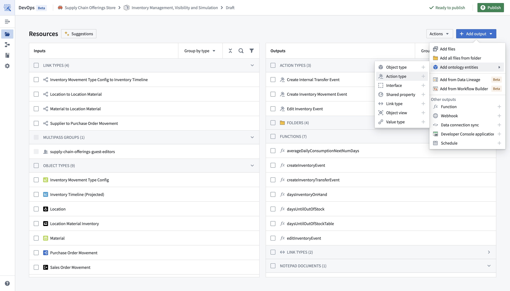
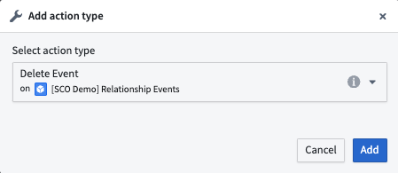
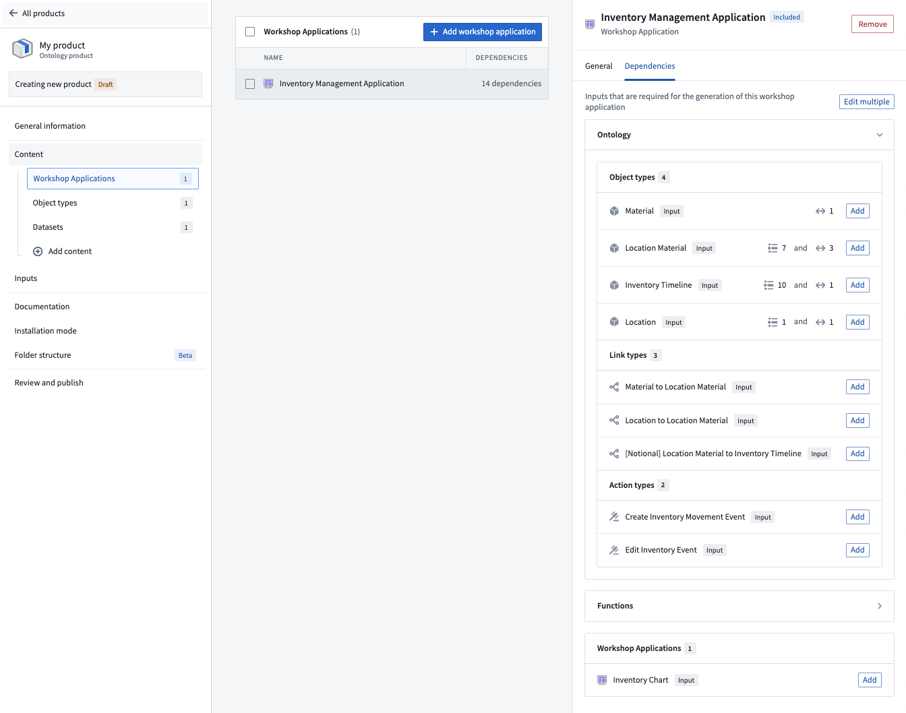

# Add action types to Marketplace product

Use [Foundry DevOps](/docs/foundry/devops/overview/) to include your action types in [Marketplace products](/docs/foundry/devops/core-concepts/#product) for other users to install and reuse. [Learn how to create your first product.](/docs/foundry/foundry-devops/create-products/)

## Supported features

Most action type features are supported, except actions that reference [object types with unsupported features](/docs/foundry/object-link-types/marketplace-ontology-types/#unsupported-features). When preparing your action type for packaging, ensure your action type [**Security & Submission criteria**](/docs/foundry/action-types/getting-started/#add-submission-criteria) does not reference a user; update any user references to refer to groups instead.

## Adding action types to products

To add an action type to a product, first [create a product](/docs/foundry/foundry-devops/create-products/) and then select the **Action type** content type as below.

You will then be prompted to choose an action type.

While you can select action types directly, we recommend first adding content like [Workshop applications](/docs/foundry/workshop/marketplace-workshop/) and then selecting relevant actions via the dependencies panel as shown below.

