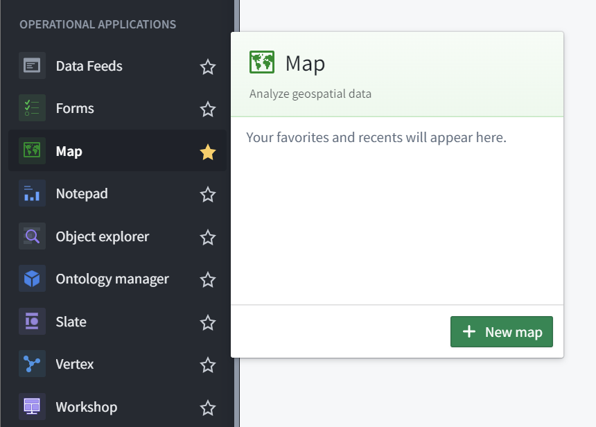

# Create and save maps

## Create a new map

To create a map, expand the left-hand side Foundry navigation bar, then click on **View all** in the Apps section. You will find the **Map** application under the **Operational Applications** section.

## Save a map

To save a map for the first time, click **Save as...** in the top-left corner of the screen and then select a location to save the map.

To save a map subsequently, click **Save** in the top-left corner of the screen.  Maps do not save automatically.

