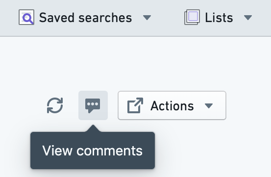

# Comment on objects

Multiple users often work with a particular object. To facilitate this cooperation, Object Explorer allows users to comment on an object, mention other users, and attach files and images.

You can open the Comments Helper for any object using the **View comments** button in the header of any Object View.

Object Explorer comments on an object are *not* related to the [Comment widget in Workshop](/docs/foundry/workshop/widgets-comments/).
